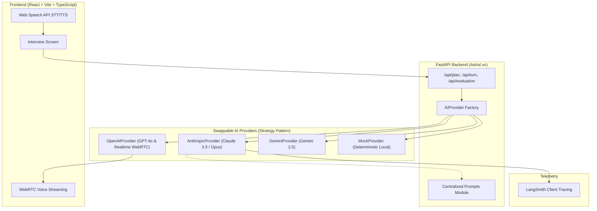

# Interviewer AI

A fullstack, production-grade AI interview preparation platform. Paste any technical study guide, configure an interview role and difficulty, practice in a turn-by-turn conversational audio/chat session, and receive rubric-based evaluations with Senior benchmark answers.

Architected with the **Strategy & Factory design patterns**, enabling swappable AI providers (**Anthropic Claude**, **OpenAI**, **Google Gemini**, and a **Deterministic Mock Provider**) with LangSmith observability tracing.

---

## 🔬 Engineering Case Study: Calibrating LLM-as-a-Judge & Eliminating Critic Bias

### 1. The Engineering Challenge: "The Moving Goalpost" Anomaly
During end-to-end testing of the evaluation pipeline, a critical systemic failure mode emerged:
* When a candidate submitted an exemplary senior answer—including pasting back the model's own previous "Senior Benchmark Answer"—the evaluator repeatedly awarded sub-senior scores (**78%–84%**) and hallucinated superficial criticisms (e.g., nitpicking CLI flag names like `--max-requests` vs. `--limit-max-requests`).
* **Root Causes Identified**:
  1. **Critic Bias**: Because the prompt mandated finding improvement areas, the LLM treated finding flaws as an unyielding constraint, inventing minor nitpicks on flawless answers.
  2. **Boundary Score Aversion**: LLMs naturally compress scores towards the 75–85% range, treating 90–100% as psychologically unreachable.

### 2. The Architectural Solution
1. **Additive Rubric Checklists**: Replaced subjective holistic grading with an additive point-accrual rubric:
   - Technical accuracy & constraints: 30 pts
   - Concrete practical examples: 20 pts
   - Senior judgment, trade-offs & alternatives: 20 pts
   - Production readiness & observability: 20 pts
   - Communication clarity & structure: 10 pts
2. **Exemplary Calibration & Full-Score Anchoring**: Explicitly instructed the model that 95–100% is expected when all criteria are met, strictly prohibiting artificial nitpicking.
3. **Staff-Level Horizon Shifting**: For scores $\ge 90$, the prompt transforms feedback from corrective fault-finding into forward-looking **Staff/Principal-level scaling frontiers** (e.g., containerized allocator fragmentation, `jemalloc`, and `MALLOC_ARENA_MAX`).

### 3. Empirical Multi-Model Benchmark Results

Following the evaluation harness methodology popularized by **EleutherAI's `lm-evaluation-harness`** (the standard testing architecture used across the **Hugging Face Open LLM Leaderboard**), we implemented an automated, reproducible A/B evaluation harness ([`backend/scripts/benchmark_eval.py`](backend/scripts/benchmark_eval.py)). 

The harness evaluated an identical, exemplary Python memory management response across all three Anthropic model tiers under two prompt paradigms (uncalibrated baseline vs. additive calibrated):

| Model Tier | Model Identifier | Baseline Score (Old) | Calibrated Score (New) | Score Delta ($\Delta$) | Qualitative Shift in Feedback |
| :--- | :--- | :--- | :--- | :--- | :--- |
| **Compact / Fast** | `claude-haiku-5-5` | 78.0% | **92.0%** | **+14.0 pts** | Shifted from CLI argument nitpicks to allocator fragmentation and RSS plateau analysis |
| **Balanced / Production** | `claude-sonnet-5-5` | 84.0% | **90.0%** | **+6.0 pts** | Explicitly labeled as *"Staff-level frontier"*: glibc malloc arenas, `jemalloc`, and `MALLOC_ARENA_MAX` |
| **Flagship / Frontier** | `claude-opus-5-5` | 82.0% | **95.0%** | **+13.0 pts** | **Top Performer (95%)**: Flawless holistic synthesis, zero false nitpicks, recognized deep production engineering |

> **Key Takeaway**: **Claude Opus (`claude-opus-5-5`) is the highest-performing evaluator**, achieving **95.0%** and demonstrating the most nuanced recognition of senior engineering trade-offs. Meanwhile, prompt calibration increased scores by an average of **+11.0 points** across all model tiers without code-level hardcoding.

### 4. Cost vs. Performance ROI Analysis (Production Strategy)

While **Opus** achieved the highest raw score, deploying it universally in production introduces significant unit economics trade-offs:

| Model | Pricing (Input / Output per 1M) | Approx. Cost per Evaluation | Calibrated Score | Recommended Production Role |
| :--- | :--- | :--- | :--- | :--- |
| **Claude Haiku** | **\$0.80 / \$4.00** | **~\$0.003** (< 1/3 of a cent) | **92.0%** | **Highest ROI**: Default for turn-by-turn chat and high-volume practice. |
| **Claude Sonnet** | **\$3.00 / \$15.00** | **~\$0.015** (~1.5 cents) | **90.0%** | **The Production Sweet Spot**: Deepest systems insights (`jemalloc`, `MALLOC_ARENA_MAX`). |
| **Claude Opus** | **\$15.00 / \$75.00** | **~\$0.080 - \$0.10** (~8–10 cents) | **95.0%** | **Enterprise Tier**: Opt-in for high-stakes executive / Staff+ evaluations. |

#### The Engineering Decision:
Paying an **~18x–25x cost premium for Opus** yields only a marginal **+3.0 point gain over calibrated Haiku (92% → 95%)**. 

Therefore, our architecture implements **Tiered Model Routing**:
1. **Interactive Turns (`next_turn`)**: Always route to **Haiku** for sub-second streaming latency and negligible token cost across multi-turn interviews.
2. **Final Rubric Evaluation (`evaluate`)**: Default to **Haiku or Sonnet** (90%–92% senior accuracy at micro-penny cost), while offering **Opus** as an opt-in toggle for candidates preparing for Staff/Principal-level interviews.

#### Reproducing the Benchmark
```bash
cd backend
# Benchmark Opus (Top Performer)
uv run python scripts/benchmark_eval.py --prompt both --runs 1 --model claude-opus-5-5

# Benchmark Haiku or Sonnet (High ROI)
uv run python scripts/benchmark_eval.py --prompt both --runs 1 --model claude-haiku-5-5
```

---

## Architecture & Design Patterns



---

## Features

- **FastAPI REST API**: Validated Pydantic request/response schemas with custom domain exceptions ([`LLMProviderError`](backend/app/exceptions.py)).
- **Multi-Provider Strategy Pattern**: Seamlessly switch between Claude, OpenAI, Gemini, or Mock via `.env` or per-request overrides.
- **LangSmith Tracing**: Full LLM lifecycle observability and prompt debugging via `wrap_anthropic`.
- **Audio Modes**:
  - **Claude Free Web Voice**: In-browser speech recognition and synthesis with zero additional API audio costs.
  - **OpenAI Realtime Voice**: Bi-directional low-latency audio over WebRTC with server-side VAD.
  - **Text Fallback**: Full keyboard chat support.
- **100% Offline Test Suite**: Comprehensive pytest suite leveraging `AsyncMock` to verify schemas, factories, and provider error states with zero external API calls.

---

## Prerequisites

- **Python 3.12+** with [Astral `uv`](https://docs.astral.sh/uv/)
- **Node.js 20+** with `npm`

---

## Getting Started

### 1. Backend Setup (using `uv`)

```bash
cd backend

# Install dependencies and sync virtual environment
uv sync

# Configure environment variables
cp .env.example .env

# Run FastAPI development server
uv run fastapi dev app/main.py --port 8000
```
API runs at `http://localhost:8000`. Interactive OpenAPI documentation is at `http://localhost:8000/docs`.

### 2. Frontend Setup

In a new terminal:

```bash
cd frontend
npm install
cp .env.example .env
npm run dev
```
Open `http://localhost:5173`.

---

## AI Provider Configuration

Edit `backend/.env`:

### Anthropic Claude (Recommended)
```dotenv
AI_PROVIDER=anthropic
ANTHROPIC_API_KEY=your_anthropic_api_key_here
ANTHROPIC_MODEL=claude-haiku-5-5  # or claude-opus-5-5

# Optional LangSmith Tracing
LANGSMITH_TRACING=true
LANGSMITH_API_KEY=<your-langsmith-key>
LANGSMITH_PROJECT=<your-project-id>
```


---

## Automated Testing & Quality Checks

Run the backend test suite:
```bash
cd backend

# Run all unit tests
uv run pytest -v

# Run linting and code quality checks
uv run ruff check .
```

---
